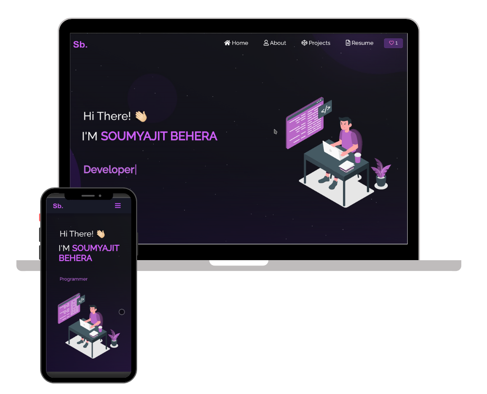

<h2 align="center">
  Portfolio Website - v2.0<br/>
  <a href="https://soumyajit.vercel.app/" target="_blank">soumyajit.tech</a>
</h2>
<div align="center">
  
</div>

<br/>

<center>

[](https://forthebadge.com) &nbsp;
[](https://forthebadge.com) &nbsp;
[](https://forthebadge.com) &nbsp;
 &nbsp;


</center>

<h3 align="center">
    🔹
    <a href="https://github.com/soumyajit4419/Portfolio/issues">Report Bug</a> &nbsp; &nbsp;
    🔹
    <a href="https://github.com/soumyajit4419/Portfolio/issues">Request Feature</a>
</h3>

## TL;DR

You can fork this repo to modify and make changes of your own. Please give me proper credit by linking back to [Soumyajit4419](https://github.com/soumyajit4419/Portfolio). Thanks!

## Built With

My personal portfolio <a href="https://soumyajit.vercel.app/" target="_blank">soumyajit.tech</a> which features some of my github projects as well as my resume and technical skills.<br/>

This project was built using these technologies.

- React.js
- Node.js
- Express.js
- CSS3
- VsCode
- Vercel

## Features

**📖 Multi-Page Layout**

**🎨 Styled with React-Bootstrap and Css with easy to customize colors**

**📱 Fully Responsive**

## Getting Started

Clone down this repository. You will need `node.js` and `git` installed globally on your machine.

## 🛠 Installation and Setup Instructions

1. Installation: `npm install`

2. In the project directory, you can run: `npm start`

Runs the app in the development mode.\
Open [http://localhost:3000](http://localhost:3000) to view it in the browser.
The page will reload if you make edits.

## Usage Instructions

Open the project folder and Navigate to `/src/components/`. <br/>
You will find all the components used and you can edit your information accordingly.

### Show your support

Give a ⭐ if you like this website!

<a href="https://www.buymeacoffee.com/soumyajit4419" target="_blank"></a>

## Kashmir Integrated Farm Hub deck

The root route now opens a presentation-ready, 10-slide web deck for Saadat's JKEDI Startup Idea Challenge 2.0 pitch.

```bash
npm install
npm start
```

Open `http://localhost:3000/` (or `/deck`). The original portfolio remains available under `/portfolio`, `/about`, `/project`, and `/resume`.

### Deck controls

- Use the arrow buttons, slide rail, or keyboard arrows to move between slides.
- Press `N` to open speaker notes.
- Press `F` to enter presentation mode.
- Use **Print / PDF** to print all 10 slides through the browser print dialog.
- Slides 01, 02, and 05 include honest upload slots for Saadat's real Mattan/orchard/founder photos. Images are previewed locally in the browser and are not sent anywhere.

The deck intentionally keeps proposed trout culture, the multi-level farm complex, pilot economics, and 2030 targets clearly labeled as conditional, conceptual, assumptions, or long-term vision.
